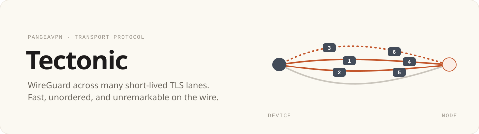

<div align="center">

<picture>
  <source media="(prefers-color-scheme: dark)" srcset="docs/assets/banner-dark.svg" />
  
</picture>

[**Design methodology**](docs/design.md) · [License](LICENSE) · [PangeaVPN](https://github.com/pangeavpn/pangeavpn-app)

</div>

---

Tectonic is PangeaVPN's own TCP transport for WireGuard. It spreads WireGuard
datagrams, unordered, across a small pool of short-lived TLS 1.3 connections
("lanes"), so a stall on one connection never holds up the others. To a
network observer each lane is Chrome loading an ordinary website.

**Status:** design stage. Nothing here is ready to use.

- [**Design methodology**](docs/design.md): how Tectonic works and why.
- Client: linked into the PangeaVPN daemon
  ([pangeavpn-app](https://github.com/pangeavpn/pangeavpn-app)).
- Server: `cmd/tectonic-server` (planned), run on VPN nodes.

## Layout (planned)

See [Design methodology § Code layout](docs/design.md#14-code-layout) for details.

| Path | Contents |
|---|---|
| `wire/` | Frames, HELLO/WELCOME, key derivation. No I/O. |
| `lane/` | One TLS lane: dial, login, frame I/O, retire. |
| `sched/` | Lane pool, scheduler, duplication, churn, throttle detection. |
| `shape/` | Shaping profiles and record-size planning. |
| `server/` | Server library: TLS listener, login check, cover-site fallback. |
| `cmd/tectonic-server/` | Node binary. |
| `bench/` | Simulated-link benchmarks against other transports. |

## Developing alongside the daemon

Until the API settles, edit both repos together with a Go workspace rather
than tagging every change. From a directory that contains both checkouts:

```sh
go work init ./pangeavpn-app/daemon ./Tectonic
```

## License

GPL-3.0, the same as the PangeaVPN client. See [LICENSE](LICENSE).
