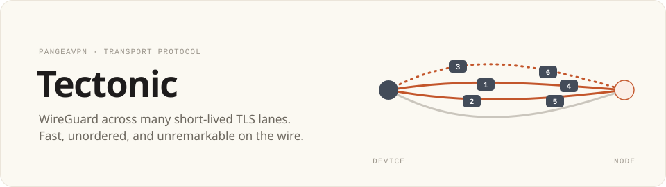
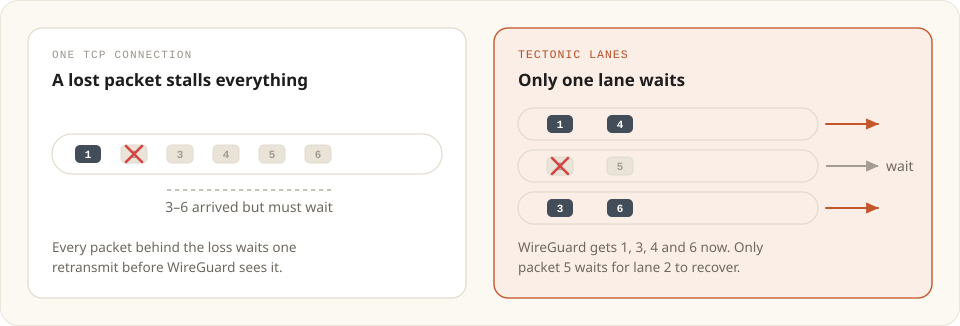
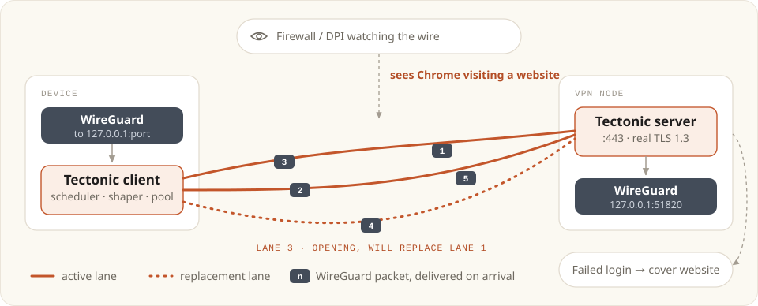
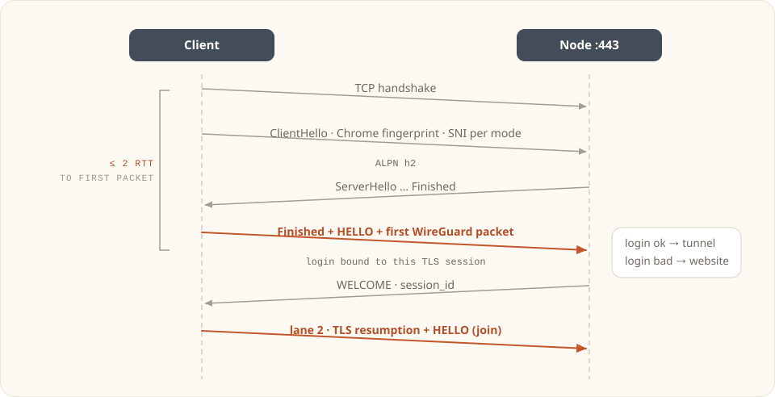
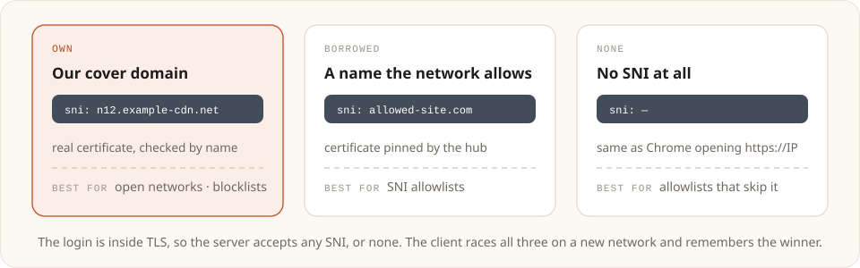

<div align="center">

<picture>
  <source media="(prefers-color-scheme: dark)" srcset="assets/banner-dark.svg" />
  
</picture>

<h3>Design methodology</h3>


[](../LICENSE)


[How it works](#3-how-it-works) · [Authentication](#5-authentication) · [Lanes](#7-lanes-and-the-scheduler) · [SNI modes](#9-sni-modes) · [Threat model](#11-threat-model) · [Milestones](#15-milestones)

</div>

---

> [!NOTE]
> **Status: draft.** This describes what we intend to build. Nothing here is implemented yet, and every number under [Measuring speed](#13-measuring-speed) is a target, not a result.

Tectonic carries WireGuard over a small pool of short-lived TLS 1.3 connections called **lanes**. Packets travel across the lanes independently and are put back in order as they arrive. Each lane has its own congestion window, so a loss slows one lane and the others keep their pace. To anyone watching the network, each lane is Chrome loading an ordinary website.

It's written in Go and shares one codebase between client and server. The client links it into the PangeaVPN daemon on desktop, Android and iOS, and the server runs on the VPN nodes.

## Contents

1. [Goals and non-goals](#1-goals-and-non-goals)
2. [What makes it different](#2-what-makes-it-different)
3. [How it works](#3-how-it-works)
4. [Connecting, step by step](#4-connecting-step-by-step)
5. [Authentication](#5-authentication)
6. [Wire format](#6-wire-format)
7. [Lanes and the scheduler](#7-lanes-and-the-scheduler)
8. [Traffic shaping](#8-traffic-shaping)
9. [SNI modes](#9-sni-modes)
10. [Carriers](#10-carriers)
11. [Threat model](#11-threat-model)
12. [Compared with existing protocols](#12-compared-with-existing-protocols)
13. [Measuring speed](#13-measuring-speed)
14. [Code layout](#14-code-layout)
15. [Milestones](#15-milestones)
16. [Open questions](#16-open-questions)

---

## 1. Goals and non-goals

### Goals

- **Fast.** Good enough to be the default transport on ordinary networks. The first packet should flow within two round trips, throughput should stay close to plain WireGuard, and packet loss should hurt it much less than it hurts single-connection TCP transports.
- **Unremarkable on the wire.** Every lane looks like Chrome talking to an ordinary HTTPS server.
- **Resilient.** It keeps working through injected resets, per-connection throttling, long-connection heuristics, SNI allowlists, and a phone moving between Wi-Fi and mobile data.
- **One protocol, several routes.** The same core runs straight to the node, or through a CDN when the node's IP address is blocked.
- **No home-made cryptography.** Real TLS 1.3 on the outside and WireGuard on the inside. Tectonic adds only authentication, framing, scheduling and shaping, built from standard primitives (HMAC-SHA256, HKDF and TLS exporters).

### Non-goals

- **IP allowlists.** No protocol gets through a network that only lets traffic reach approved IP addresses. SNI allowlists are a different matter; [section 9](#9-sni-modes) covers them.
- **Secrecy.** The code is public under GPL-3.0, and nothing in the design depends on a censor not knowing how it works.
- **Replacing WireGuard.** Tectonic only carries WireGuard. WireGuard still provides the end-to-end encryption and keys.

---

## 2. What makes it different

Most of these ideas exist somewhere in some form. What's new is combining them, and designing every part around the fact that the payload is always WireGuard datagrams, never a byte stream.

<picture>
  <source media="(prefers-color-scheme: dark)" srcset="assets/head-of-line-dark.svg" />
  
</picture>

> [!NOTE]
> The figure shows the idea as first drawn, with packets handed to WireGuard the moment they arrive. Measured that way, the TCP connections inside the tunnel took every packet that arrived out of turn for a lost one. As built, the receiver puts packets back in order and waits for a late one, so a lost segment delays the tunnel much as it would delay one connection; see [Putting packets back in order](#putting-packets-back-in-order). What lanes add under loss is capacity, not less delay.

| | Idea | What it does |
|---|---|---|
| 01 | **Unordered lanes** | WireGuard packets are spread across several TLS lanes, with no order shared between them. The receiver merges them back into WireGuard's own order, waiting for a late packet while its lane's TCP recovers. Each lane has its own congestion window, so on a lossy path the lanes together carry more than one connection would. |
| 02 | **Free deduplication** | WireGuard's anti-replay window already drops duplicate packets. That lets us send a small, urgent packet on two lanes without any bookkeeping on the receiving end. |
| 03 | **Lane churn** | Each lane lives from tens of seconds to a few minutes, and a replacement opens before the old one closes, the way a browser cycles connections. No single connection runs for hours or carries gigabytes. |
| 04 | **Throttle detection** | If adding a lane raises total throughput while each lane stays capped, the network is throttling per connection. Tectonic responds by adding lanes, up to a limit. |
| 05 | **Our own identity** | By default each node serves a real website on a domain we own, with a real certificate. SNI, IP address and certificate all agree. |
| 06 | **Channel-bound login** | The login is tied to its TLS session through a TLS exporter, so a captured login doesn't work on any other connection. A probe that fails it is served the website. |
| 07 | **Shaping budget** | Padding is added only when the real traffic would give WireGuard away: handshakes, keepalives and idle periods. A large download already looks like a download, so it gets no padding. |
| 08 | **Sessions outlive connections** | A session belongs to the device, not to a TCP connection. Every lane can drop during a network change, and the new lanes rejoin the same session. |
| 09 | **Any SNI, or none** | The login happens inside TLS, so the server accepts whatever name the network allows, or no name at all. |

---

## 3. How it works

<picture>
  <source media="(prefers-color-scheme: dark)" srcset="assets/lanes-dark.svg" />
  
</picture>

On the device, WireGuard sends to a loopback port, as it does with every other PangeaVPN transport. The Tectonic client spreads those packets across its lanes. The server merges what arrives on the lanes back into the order WireGuard sent it and passes it to the node's WireGuard. A packet waits only while an earlier one is still on its way on another lane.

From the daemon's point of view, Tectonic is one more transport. It brings up a loopback UDP listener and points WireGuard's endpoint at it.

---

## 4. Connecting, step by step

<picture>
  <source media="(prefers-color-scheme: dark)" srcset="assets/connect-dark.svg" />
  
</picture>

1. **Provisioning.** When the user connects, the hub returns a `tectonic` profile block containing the node address, a cover domain, a `key_id` and a `device_key`, plus an optional CDN route.
2. **First lane.** The client opens TCP to the node and starts a TLS 1.3 handshake with Chrome's ClientHello (via uTLS), offering ALPN `h2`. The SNI depends on the [SNI mode](#9-sni-modes).
3. **Login in the first flight.** As soon as the TLS handshake completes, the client sends `HELLO`, padded to the size of Chrome's first HTTP/2 flight, without waiting for a reply. The first WireGuard packet goes out in the same write.
4. **The server decides.** The server buffers the client's first flight and checks the `HELLO`. If it passes, the server replies `WELCOME` and the lane carries tunnel traffic. If it fails, the buffered bytes go to the cover website's HTTP server, which answers as it would answer any visitor.
5. **More lanes.** A second lane opens straight away using TLS session resumption, the way a returning browser reconnects, and joins the same session.
6. **Steady state.** Lanes are retired and replaced on a browser-like schedule, and the pool grows if per-connection throttling is detected.
7. **Network change.** If every lane dies, the client reconnects with the same `session_id` within the resume window (60 s by default). WireGuard's session carries on without noticing.

> [!TIP]
> **Time to first packet** is one TCP round trip plus one TLS 1.3 round trip. Logging in adds nothing, because the client doesn't wait for `WELCOME` before it starts sending.

---

## 5. Authentication

### Keys without per-device sync

Each node, or each region, holds one secret, `node_secret`. The hub knows every node's secret and issues each device a credential for the node it's about to use:

```text
key_id     = 16 random bytes ‖ expiry (uint32, unix days)        // 20 bytes
device_key = HMAC-SHA256(node_secret, "tectonic device v1" ‖ key_id)
```

The node recomputes `device_key` from the `key_id`, so it needs no device database and nothing synced from the hub. A `key_id` can't be forged, and its expiry can't be extended, without knowing `node_secret`. The hub reissues credentials before they expire. To revoke one early, the hub pushes a short list of `key_id`s to deny.

### HELLO

```text
exporter = TLS-Exporter("EXPORTER-tectonic-hello", context = "", 32 bytes)
lane_key = HKDF-SHA256(ikm = device_key, salt = exporter, info = "tectonic lane v1")

HELLO
  version     1 byte    = 1
  flags       1 byte    bit 0: join an existing session
  key_id     20 bytes
  session_id 16 bytes   zeros for a new session
  timestamp   8 bytes   unix seconds
  tag        32 bytes   HMAC-SHA256(lane_key, all fields above)
```

- **Channel binding.** The exporter value is unique to each TLS connection, so a `HELLO` copied from one connection fails on every other. The ±120 s timestamp window is a second line of defence against replay.
- **Joining a session** requires the same `key_id` that created it, so a leaked `session_id` is useless on its own.
- **Constant-time checks.** Success and failure take the same time, so a probe learns nothing from how fast the server answers.

### When the login fails

The server never sends a Tectonic-specific error. Whatever bytes arrived go to the cover website's HTTP handler. A valid HTTP request gets the site, and anything else gets an ordinary `400 Bad Request` and the connection closed.

---

## 6. Wire format

Inside TLS, a lane carries a series of frames. Several frames can share one TLS record, and the shaper decides how big each record is.

```text
frame = type (1 byte) ‖ length (2 bytes, big-endian) ‖ body (length bytes)
```

| Type | Name | Direction | Body |
|---|---|---|---|
| `0x01` | `HELLO` | C → S | The login described above. Always the first frame on a lane. |
| `0x02` | `WELCOME` | S → C | `session_id`, `max_lanes`, `resume_window`, shaping profile ID |
| `0x03` | `DATA` | both | Exactly one WireGuard datagram. No sequence number, because WireGuard's own counters handle ordering and duplicates. |
| `0x04` | `PAD` | both | Zeros. Thrown away on receipt. |
| `0x05` | `PING` / `PONG` | both | An 8-byte token, used to measure each lane's round-trip time |
| `0x06` | `RETIRE` | both | "No new `DATA` on this lane." The lane finishes what it's sending, then closes with TLS `close_notify`. |
| `0x07` | `CLOSE` | both | Ends the whole session. 1-byte reason code. |
| `0x08` | `LOST` | both | A WireGuard key index, a counter and a count: datagrams the sender dropped, or never received from WireGuard, and will not send. The receiver stops waiting for them. |

A receiver skips any frame type it doesn't recognise, using the length field, so new frame types can be added without breaking older clients.

---

## 7. Lanes and the scheduler

### Choosing a lane

For each outgoing WireGuard packet, the scheduler estimates when each lane would deliver it:

```text
eta(lane) = queued_bytes(lane) / rate(lane) + srtt(lane) / 2
```

It keeps the lanes in order of preference, newest first, and sends the packet on the most preferred lane whose estimate is within a small margin (a sixteenth of that lane's round trip) of the earliest.

- **One lane while one lane is enough.** Traffic a single lane can carry stays on that lane, in order. Once the lane falls behind, the overflow spills to the next, and each packet still goes where it should arrive about as early as anywhere.
- **Shallow socket buffers.** Each lane sets `TCP_NOTSENT_LOWAT`, so the operating system holds only a little unsent data. The queue stays in Tectonic's scheduler, which can still steer packets to the fastest lane. This also keeps latency low while the tunnel is busy.
- **What the kernel holds counts.** Where the platform has `TCP_INFO`, `queued_bytes` includes the bytes the kernel has taken and not sent, and `rate` is what the connection can send now: its congestion window each round trip, or its pacing rate if it paces. The lane reads them again whenever it writes, and at most every millisecond while anything is in flight. A connection that has just opened may send ten segments and then nothing for a round trip. Counted by its own queue alone it looks empty, and takes packets that then wait in the kernel while another lane had room.
- **Without `TCP_INFO`,** rate and RTT come from `PING`/`PONG`.
- **A record is no larger than the lane sends in a moment.** Nothing in a TLS record can be used until all of it has arrived, so a record holds no more than its connection sends in a thirty-second of the round trip (between 1 and 4 ms), and always at least one packet. At 100 Mbit/s that is a full 16 KB record. On a paced connection that has just opened it is one packet.
- **Paced or not.** A connection that paces (BBR, or any connection on a host whose queueing discipline is `fq`) sends at its pacing rate however much window it has. One that doesn't sends whatever its window has room for at once, so that much can share a record. The kernel reports a pacing rate either way. A lane takes its connection to pace if it runs BBR, or once it has been seen holding back segments its window had room for.
- **Small packets first.** Within a lane, packets of 128 bytes or less go out ahead of the larger ones queued there, so a download doesn't make pings and ACKs wait behind it.
- **A full queue drops.** A lane's queue is full once its oldest packet has waited about a round trip. When every lane is full the packet is dropped, which the TCP connections inside the tunnel read the way they would read a full link. The sender tells the receiver which packets it dropped (`LOST`), so the receiver does not wait for them.

Both the estimate and the record limit matter most while a TCP connection inside the tunnel is in slow start. It stops growing as soon as its round trip rises by an eighth (HyStart), and a few packets held up for a round trip behind a new lane's window, or for tens of milliseconds inside a large record on a slow lane, are enough. Measured on a 150 ms path, the connection left slow start at 29 packets without them and at about 1300 with them.

### Without `TCP_NOTSENT_LOWAT`

Where the socket option is missing (Windows, and the benchmark's simulated hosts), a lane has to keep the kernel's buffer shallow by itself. It sends `PING`s several times a round trip and treats the bytes no `PONG` has confirmed as still outstanding.

- **Window.** The lane writes no more than a multiple of what it delivers in one round trip: three times while `PONG`s come back on time and its rate is still rising, as it does while the connection is in slow start; twice once the rate is steady; one and a half times once `PONG`s come back late, which means bytes are already waiting below it.
- **Estimate.** `queued_bytes` counts the outstanding bytes too, less what the connection carries in flight without any of it waiting. A lane is offered a little more than it was last seen to deliver, and only while its `PONG`s are on time. A new lane isn't counted on until its first `PONG` is back.
- **Pacing.** A lane that is at its capacity spaces its writes out, so a burst from the tunnel waits in the lane's queue instead of overflowing a queue on the path.

The aim throughout is that anything the tunnel can't carry yet waits in Tectonic's queue, where it can be steered or dropped, and not below it. A queue on the path that overflows drops the lane's own TCP segments, and the lane then stalls on a retransmission.

### When a lane's congestion control doesn't push back

All of the above leans on each lane's own congestion control to say what the path carries: a connection that is sending all it may takes no more, its lane's queue fills, and a full queue drops. Not every congestion control says so. BBR starts a connection at nearly three times the rate it has measured, and leaves that phase only after several round trips with data always waiting to be sent. The TCP inside the tunnel is clocked by its own acknowledgements and rarely offers a lane more than the lane is carrying, so a BBR lane can stay in that phase for as long as it lives, passing on whatever it is given. Nothing then stands between the TCP inside the tunnel and the queue on the path. On a clean link with a BBR node, the lanes retransmitted a quarter of what they sent.

So a session has a send limit of its own, shared by its lanes.

- **Off until the path shows it is overloaded.** Over a stretch of two round trips, the lanes' connections retransmitted more than 5% of what they sent while their round trips had risen, which means a queue on the path. Two such stretches in a row bring the limit on. Loss alone doesn't: a path can lose packets at random, and a lane that rides that out is doing what it should. A connection that backs off when it loses packets has done so by the second stretch.
- **Then the session writes no faster than the path has been delivering.** What the tunnel offers beyond that waits in the lanes' queues, where a full queue drops. Small packets and control frames don't wait.
- **The rate follows the path smoothly.** Every time it falls, the lanes' queues fill and drop, and a TCP connection made to back off every second never gets back to what the path carries. So the rate moves a percent or two a stretch: up while there is no queue on the path, and with a queue it settles where the path drops about 2% of what it is sent. Only when the path is found overloaded again does it jump back to what is being delivered.
- **It goes when it isn't needed,** once the session has used less than half of it for a while.
- **It stands down on a path it doesn't fit.** On a path that limits each connection separately, a lane given more than its connection may carry loses the excess while another lane has room, so holding the session to what it delivers makes it deliver less again. If the rate falls under 70% of the highest it has been, the limit stands down, for 30 s the first time and twice as long each time after.

The figures come from `TCP_INFO`, so the limit works where a lane has it and stays off elsewhere.

### Putting packets back in order

Lanes are separate TCP connections, so packets spread across them arrive out of order. A TCP connection *inside* the tunnel reads a packet that turns up late as a lost one: it retransmits and slows down for a loss that never happened. The receiver therefore merges the lanes back into one ordered stream before handing packets to WireGuard.

- **No sequence numbers.** WireGuard's data header is in the clear and carries a counter that rises by one per packet. The merge uses that.
- **Late or lost.** Each lane is an ordered, reliable stream, and the sender puts packets on a lane in counter order. So a lane that has delivered counter *c* will never deliver anything below *c*. A missing packet is known to be lost the moment every lane has delivered something beyond it, and the packets behind it go on at once. Until then it is still on its way, and they wait for it.
- **The sender says what it dropped.** A packet that no lane would take, or that never reached Tectonic from WireGuard (a socket buffer overflowed), is not late. It is gone, and only the sender knows. The sender follows WireGuard's counters too, and reports the gaps in a `LOST` frame on the lane that takes the next packet. The receiver gives those packets their places in the order without waiting.
- **Everything else is waited for.** A packet that was put on a lane arrives, unless the lane dies: if a segment is lost, TCP sends it again, and the lane delivers nothing until it has. So the packets behind a gap wait for it: four of the lane's round trips plus 200 ms, and at most a second. That covers a fast retransmission (one to two round trips, which themselves double while a queue on the path is full) and a first retransmission timeout (the round trip plus at least 200 ms). The limit is for a lane that has died without closing, which costs one stall of that length.
- **But not on a lane that was already quiet.** That long wait is for a lane that was delivering when the gap appeared and then went silent: it has most likely lost a segment. A lane that had delivered nothing for two round trips before the gap is idle, or has only just joined, and the missing packet was more likely on a lane that has since died (a reset closes a lane with whatever was on it). If every lane that could still deliver the packet is like that, the wait is one and a half round trips (between 20 and 150 ms): long enough for a packet put on an idle lane at that moment to arrive.
- **Why not sooner.** Handing on the packets behind a gap while the gap is still on its way looks like loss to a TCP connection inside the tunnel: it sends the whole stretch again and slows down. The first version waited one and a half round trips, just under what a fast retransmission takes. Measured on Linux TCP it gave up on thousands of packets a run, nearly all of which then arrived, and carried less than half as much.
- **Small packets don't wait.** Packets of 128 bytes or less, and anything that isn't WireGuard data, are handed on as they arrive.

### Duplicating small urgent packets

While any lane is retransmitting, packets of 128 bytes or less are also copied onto the next-best lane. That covers WireGuard handshakes, keepalives, and most TCP ACKs from inside the tunnel. Duplication is capped at 5% of bandwidth and removes most of the latency spikes that loss would otherwise cause. The receiver doesn't need any logic for this, because WireGuard silently drops the second copy.

### Lane churn

- Each lane's lifetime is drawn from a browser-like distribution (median about 90 s, range 20 s to 6 min), and its byte budget is drawn the same way (median about 40 MB).
- Shortly before a lane expires, a replacement opens with TLS resumption. As the newest lane it takes the traffic, as fast as its connection can grow, while the old lane carries the rest. Once the traffic has moved off the old lane, it is sent `RETIRE`, finishes sending, and closes. The number of working lanes never drops during the switch.
- A new TCP connection next to a busy one grows slowly, so on a saturated link the old lane can stay for many seconds. It is retired regardless after 30 s, or once it has carried the most any lane's byte budget can be.
- If the network kills a lane, for example with a forged reset or a middlebox timeout, traffic moves to the remaining lanes at once and a replacement opens.

### Lane count and throttle detection

- The pool starts with 2 lanes and can grow to `max_lanes`. The server sets that limit: 6 by default, and 3 on cellular.
- **Throttle check.** Under load, if every lane settles at about the same rate and adding a lane adds about that much more again, the network is limiting each connection separately. The client keeps adding lanes while each one pays off, and closes lanes once they stop helping.
- When the tunnel is idle, the pool shrinks to a single lane.

---

## 8. Traffic shaping

TLS hides what's inside the traffic, but WireGuard still has a recognisable shape: 148-byte and 92-byte handshakes, a fixed 32-byte keepalive on a regular timer, and MTU-sized data packets. Tectonic changes only what an observer can measure from outside, which is TLS record sizes and their timing.

| Traffic state | What Tectonic does | Overhead |
|---|---|---|
| Bulk transfer | Packs `DATA` frames into records of up to 16 KB, like a real download. A slow lane that paces sends smaller ones (see [Choosing a lane](#choosing-a-lane)). | ≈ 0% |
| Interactive | Gives a record up to a millisecond to fill, then rounds its size up to a bucket taken from a recorded browsing profile. A few packets that would need a lot of padding together are divided between two records that each fit a bucket closely. | Small |
| Lane start | Pads the first flight in each direction to match Chrome loading a page over HTTP/2 | Once per lane |
| Idle | Absorbs WireGuard keepalives into browser-like idle behaviour, closes the lane, and opens a fresh one when traffic resumes | Tiny |

The wait matters as much as the padding. Packets inside the tunnel come in trains: the segments of a reply, the ACKs that answer them. Sent one to a record, each pays for its own TLS framing, its own padding and, being slightly larger than one TCP segment with them, two TCP headers. A millisecond is enough to turn a train into one record.

Shaping profiles are data, not code. `WELCOME` tells the client which profile to use, so new profiles can be rolled out from the hub without a protocol change.

> [!WARNING]
> **The limit of shaping.** Shaping makes classification harder and more expensive. It can't rule out a well-resourced censor running machine-learning classifiers over whole flows. That's why the rest of the PangeaVPN transport cascade stays in place behind Tectonic.

---

## 9. SNI modes

<picture>
  <source media="(prefers-color-scheme: dark)" srcset="assets/sni-modes-dark.svg" />
  
</picture>

Networks filter on the handshake's server name in different ways, so the SNI is a per-network setting rather than one fixed value. Because the login happens *inside* TLS, **the server accepts any SNI, or none at all**.

| Mode | SNI sent | Certificate check | Best for |
|---|---|---|---|
| **Own** | The node's cover domain | Real Let's Encrypt certificate, verified by name | Open networks and blocklist censors. SNI, DNS, IP and certificate all agree. |
| **Borrowed** | Any name the network allows, from a list the hub supplies or typed in by the user | The node's default certificate, verified by SPKI pin | SNI allowlists that read the name but don't check it against the destination IP |
| **None** | No SNI extension, which is exactly what Chrome sends when it opens `https://<IP>` | Default certificate, verified by SPKI pin, or a Let's Encrypt IP certificate | SNI allowlists that let connections without an SNI through |

- **The certificate is hidden from the filter.** TLS 1.3 encrypts the server certificate, so a filter watching passively never sees that it doesn't match a borrowed name. The client still verifies the node through the pin.
- **How the server chooses a certificate.** If the SNI is the node's own domain, the server presents the real certificate. For any other name, or no name, it presents its default certificate, which is how most web servers behave.
- **Active probes in borrowed mode** receive the default certificate and the cover website. That's ordinary behaviour for a server, though not a perfect disguise. REALITY handles this case better, which is one reason it stays in the cascade.
- **Picking the mode automatically.** On a network it hasn't seen before, the client tries all three modes in parallel for the first lane and keeps the first one that logs in. It remembers that mode for the network, so the next connection goes straight to it. Allowlist filters usually reject a blocked handshake within one round trip, so trying all three costs very little.

### Domains for Own mode

- Nothing about a domain links it to PangeaVPN: no brand name in it, private WHOIS, and a registrar and DNS host different from ours.
- Every certificate is published in public Certificate Transparency logs, which censors can watch for new domains. Wildcard certificates keep each node's subdomain out of those logs.
- Use a few base domains, each with a subdomain per node. If one base domain gets blocked, the hub moves its nodes to a fresh one.
- Every domain serves a plausible small website.

---

## 10. Carriers

The core (login, frames, scheduler and shaper) doesn't care how a lane reaches the node.

| Carrier | What a lane is | When it's used |
|---|---|---|
| **Direct** | A TLS 1.3 connection to the node on port 443, using one of the [SNI modes](#9-sni-modes) | By default. This is the fastest route. |
| **CDN** | A WebSocket over TLS to a CDN edge, which forwards it to the node. `HELLO` is sent in the first WebSocket message, and the node also checks a header signed by the CDN. | When direct lanes can't open, for example because the node's IP is null-routed |

The client switches carriers within the same session, and direct and CDN lanes can briefly run side by side during the switch. The user sees one transport, Tectonic, that keeps working.

---

## 11. Threat model

| Attack | Tectonic's answer | What's left |
|---|---|---|
| Passive DPI on the handshake | Chrome's ClientHello via uTLS. In Own mode, SNI, IP and certificate all agree. | uTLS has to keep up with Chrome releases |
| Active probing | A probe that fails login gets the cover website, with the same timing as a successful login | The cover site has to look real and maintained |
| Replaying a captured login | The login is bound to its TLS session's exporter, and checked against a timestamp window | None known |
| Long-connection and volume heuristics | Lane churn limits each connection's lifetime and byte count | Many connections from one client to one server is itself a pattern, though browsers make many connections too |
| Per-connection throttling | Throttle detection adds lanes | A per-host throttle, which caps all connections to one server together, can't be beaten this way |
| Injected TCP resets | The lane is replaced and traffic continues on the others | Resetting every lane at once forces a rejoin, which takes about 2 RTT |
| Packet size and timing analysis | The shaping budget hides WireGuard's fixed sizes and keepalive timer | Machine-learning classifiers ([section 8](#8-traffic-shaping)) |
| SNI allowlist | Borrowed or None mode, chosen automatically and remembered per network | A filter that checks borrowed names against their real IPs *and* drops connections with no SNI. The CDN carrier is next. |
| Node IP blocked | CDN carrier | The CDN itself blocked. The cascade continues. |
| Cover domain blocked | The hub moves the node to a new domain | Needs a supply of domains |
| IP allowlist | Out of scope | Any protocol fails here |

---

## 12. Compared with existing protocols

This is a broad comparison of public designs. Each of them solves a real problem well.

| Protocol | What it does | How Tectonic differs |
|---|---|---|
| VLESS + REALITY | Borrows another site's TLS identity, and its server only accepts the names it's configured for | Uses our own identity by default. When it borrows a name, it accepts any name, or none. Traffic is spread across lanes rather than one connection. |
| Trojan | Real TLS plus a password, with a fallback website, over one long-lived stream | The login is bound to the TLS session, so it can't be replayed. Lanes churn, and a datagram isn't tied to one connection's order. |
| Cloak | Hides its login in ClientHello fields and multiplexes ordered streams over several connections | The ClientHello is untouched Chrome. Datagrams, not streams, are merged, with a bounded wait: a lane that dies without closing holds the others up for a second at most, and one that is reset for a round trip or two. |
| AnyTLS | TLS with padding aimed at defeating TLS-in-TLS detection | There's no TLS inside the TLS, because the payload is WireGuard. Shaping targets WireGuard's own patterns and costs nothing during bulk transfer. |
| NaiveProxy | Uses Chrome's real network stack and HTTP/2 CONNECT | Pure Go with no native library, so it runs on iOS too. Multiple lanes and datagram-native framing. |
| Speed-first VPN protocols | Built for speed, with little or no disguise | Speed comes from the scheduler, while the traffic still looks like browsing |

---

## 13. Measuring speed

`bench/` runs the client and server in a single process over a simulated link, where bandwidth, RTT, random and burst loss, and a per-connection rate cap can all be set. It compares Tectonic against REALITY and AnyTLS under identical conditions.

| Measurement | Target |
|---|---|
| Time to first WireGuard packet | ≤ 2 RTT |
| Throughput on a clean link (100 Mbit/s, 50 ms) | ≥ 90% of plain WireGuard over UDP |
| Throughput with 1% random loss | Clearly above REALITY and AnyTLS |
| Throughput under a 4 Mbit/s per-connection cap | Rises with the number of lanes, up to `max_lanes` |
| Latency under load | Ping inside the tunnel stays within 2× idle RTT during a saturating download |
| Recovery from a reset lane | No visible stall in a TCP transfer inside the tunnel |
| Bandwidth overhead | ≤ 3% during bulk transfer, ≤ 15% during interactive use |

> [!IMPORTANT]
> Tectonic won't be called faster until these numbers exist. After the lab benchmarks come field tests on real censored networks, through opt-in builds.

---

## 14. Code layout

This repository holds the protocol, and the PangeaVPN daemon imports it.

| Path | Contents |
|---|---|
| `wire/` | Frames, `HELLO` and `WELCOME`, key derivation. No I/O; unit- and fuzz-tested. |
| `lane/` | A single lane: dial, TLS, login, frame I/O, retire |
| `sched/` | The lane pool, scheduler, resequencer, duplication, churn and throttle detection |
| `shape/` | Shaping profiles and record-size planning |
| `server/` | The server: TLS listener, login check, cover-site fallback, session table, UDP forwarding to WireGuard |
| `client.go` | A small public API that dials a profile and returns a datagram connection for WireGuard |
| `cmd/tectonic-server/` | The node binary |
| `bench/` | Simulated-link benchmarks |

In [pangeavpn-app](https://github.com/pangeavpn/pangeavpn-app), the integration is a thin `daemon/internal/tectonic` adapter that implements the daemon's transport interfaces. That repo also gets a `TectonicProfile` in the daemon state, a `tectonic` entry in the transport cascade, and a Tectonic option in the desktop, iOS and Android apps.

---

## 15. Milestones

| | Milestone | Done when |
|---|---|---|
| M0 | Design sign-off | This document is agreed and the open questions are answered |
| M1 | Core, single lane | `wire`, `lane` and `server` exist. An in-process end-to-end test carries a real WireGuard handshake, and a probe that fails login gets the cover site. |
| M2 | Lanes | The scheduler, in-order merging, duplication, churn and throttle detection work, and the benchmark harness has first numbers |
| M3 | Daemon integration | Tectonic can be chosen explicitly in the daemon. It isn't yet part of the automatic cascade. |
| M4 | Node deployment | `tectonic-server` and a cover site run on the nodes, and the hub issues credentials |
| M5 | SNI modes and shaping | All three SNI modes are chosen and remembered automatically per network. Shaping profiles are recorded from real Chrome sessions. A fingerprint audit is done. |
| M6 | CDN carrier | Lanes run over WebSocket through a CDN, and the client switches between direct and CDN carriers within a session |
| M7 | Apps and default | Tectonic is in the transport picker on all platforms. It becomes first in the automatic cascade once field data supports it. |

---

## 16. Open questions

1. **Domains.** One base domain per group of nodes, and who registers and rotates them?
2. **Node deployment.** Who deploys `tectonic-server`, and is port 443 free on every node?
3. **Hub changes.** The hub needs to hold the `node_secret`s and issue `key_id`/`device_key` pairs. It also needs a revocation list.
4. **Custom SNI in the apps.** A setting where users on allowlist networks type in a name their network allows. Which names should the hub supply by default?
5. **Mobile limits.** The maximum lane count on cellular, and whether lane churn costs noticeable battery.
